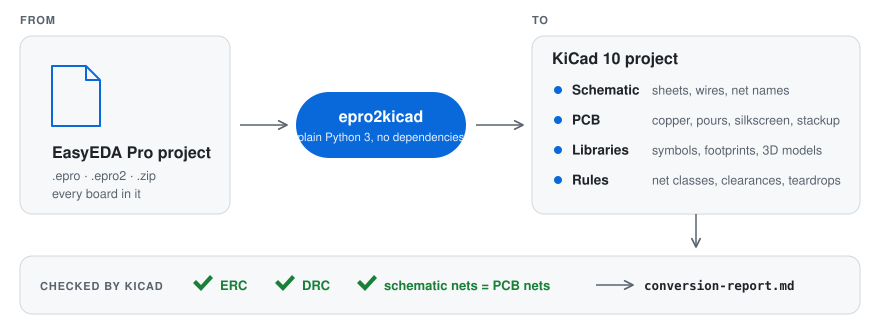
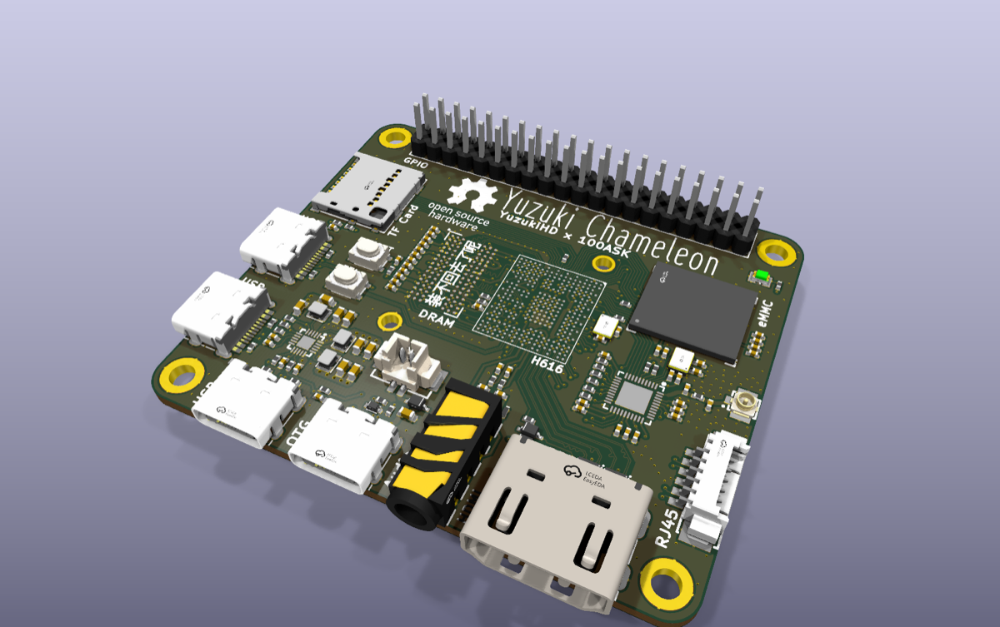
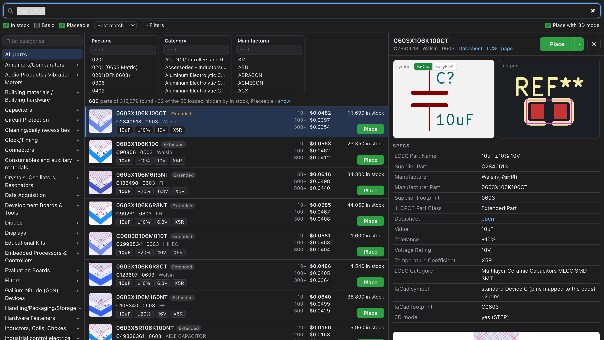

# epro2kicad

Turn **EasyEDA Pro** projects into native **KiCad 10** projects, and place **LCSC parts** from inside KiCad.

<picture>
  <source media="(prefers-color-scheme: dark)" srcset="docs/flow-dark.svg">
  
</picture>



## Install

Needs Python 3 and KiCad 10. Close KiCad first.

```sh
git clone https://github.com/filipton/easyeda-to-kicad
cd easyeda-to-kicad
python3 -m epro2kicad.install
```

`--uninstall` removes it again.

## Import a project

| From | How |
|---|---|
| Schematic or PCB editor | **Import EasyEDA Pro project**, right end of the top toolbar |
| Any KiCad window (macOS) | **KiCad → Services → Import EasyEDA Pro Project…** or `⇧⌘I` |
| Finder | double-click an `.epro` / `.epro2`, or drop it on the import window |
| Terminal | `python3 -m epro2kicad MyProject.epro2` |

Each board becomes its own KiCad project folder, with a `conversion-report.md` saying what was translated and what
KiCad's checks found.

## What carries over

| | |
|---|---|
| **Schematic** | sheets, wires, net names and power symbols; *Update PCB from Schematic* finds nothing to change |
| **PCB** | tracks, vias, pours, plane layers, silkscreen text where EasyEDA prints it, stackup, teardrops |
| **Rules** | net classes, clearances, track and via sizes, as KiCad constraints and custom rules |
| **Libraries** | one symbol and one footprint library per board, 3D models on request |

## LCSC parts

`Shift+A` or the **LCSC parts** toolbar button in the schematic editor. Search, filter by parameter, see stock and
prices, and place a part with its symbol, footprint and 3D model. It works from the keyboard: type, `↑` `↓`, `Enter`.



## Command line

```sh
python3 -m epro2kicad MyProject.epro2 -o out/      # every board
python3 -m epro2kicad MyProject.epro2 -b Main --3d # one board, with 3D models
python3 -m epro2kicad.lcsc C2040 C25804            # add LCSC parts to the current project
```

| Option | |
|---|---|
| `--list` | show the boards and stop |
| `-b NAME` | only this board (repeatable) |
| `--3d` | download STEP models from the EasyEDA library |
| `--kicad-symbols` | use KiCad's standard symbols where the netlist stays identical |
| `--tolerance UM` | let limits missed by this many µm pass as rounding (default 3, `0` keeps the rules exact) |

## Checking a translation

```sh
python3 -m epro2kicad.test_convert && python3 -m epro2kicad.test_stock
uv run --with numpy --with pillow tools/gerber_check.py MyProject.epro2 Gerber_MyBoard.zip
```

`gerber_check.py` compares the result with EasyEDA's own Gerber export: every layer, every silkscreen text and every
hole.
