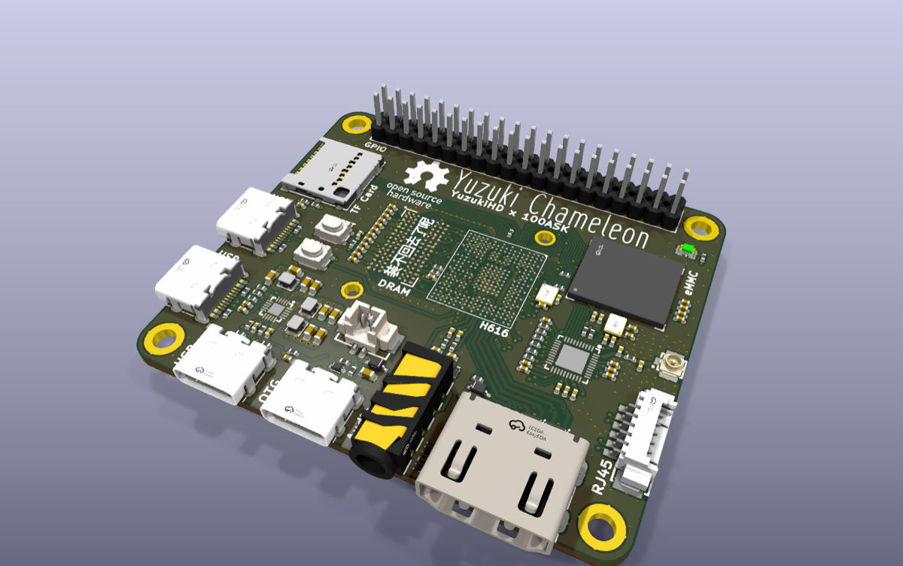
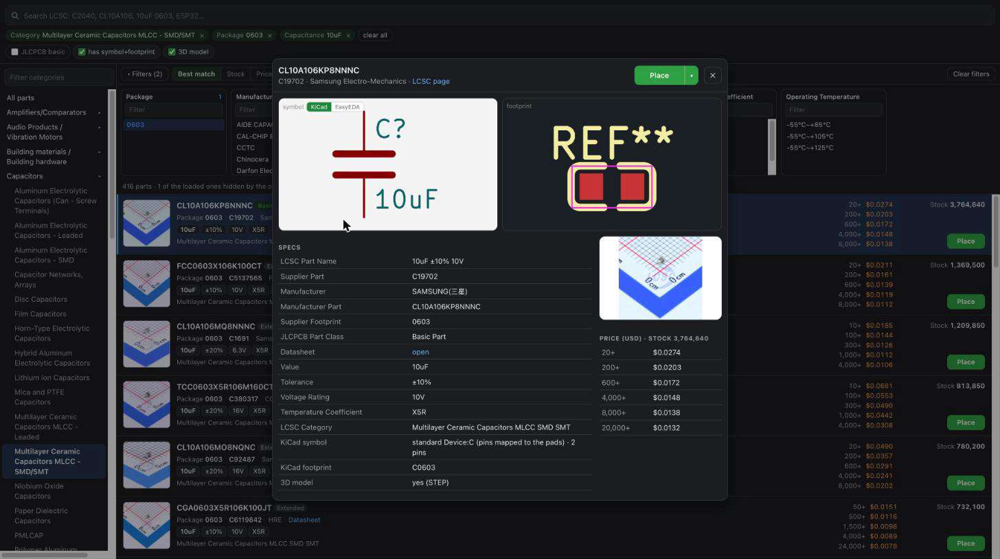

# epro2kicad

Convert **EasyEDA Pro** projects (`.epro`, `.epro2`, `.zip`) into native **KiCad 10** projects, and search/place
**LCSC parts** right inside KiCad, like in EasyEDA Pro.

No dependencies beyond Python 3 and KiCad 10.



## Why not KiCad's built-in importer?

- Verified: KiCad ERC, DRC and a net-by-net schematic ↔ PCB check, written to `conversion-report.md`
- Schematic and PCB in sync: *Update PCB from Schematic* finds nothing to change
- Design rules, net classes, stackup and teardrops carried over
- Copper pours and silkscreen text match EasyEDA's output
- Proper project libraries, optional 3D models and KiCad's standard symbols

## LCSC parts browser

`Shift+A` in the schematic editor: search, categories, parametric filters, stock and prices, one-click place.



## Install

```sh
git clone https://github.com/filipton/easyeda-to-kicad
cd easyeda-to-kicad
python3 -m epro2kicad.install        # close KiCad first
```

Then enable **Settings → Plugins → Enable KiCad API** in KiCad. Uninstall with `--uninstall`.

## Usage

In KiCad, click **Import EasyEDA Pro project** in the toolbar. On macOS you can also double-click an `.epro` file.

```sh
python3 -m epro2kicad MyProject.epro -o out/       # convert all boards
python3 -m epro2kicad MyProject.epro -b Main --3d  # one board, with 3D models
python3 -m epro2kicad.lcsc C2040 C25804            # add LCSC parts to the current project
```

`--list` shows the boards, `--kicad-symbols` uses KiCad's standard symbols where the netlist stays identical.
